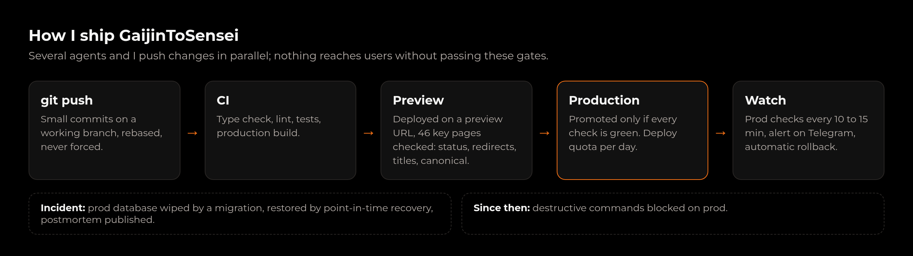
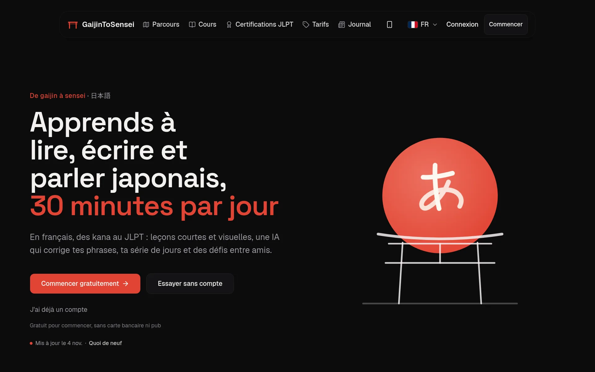
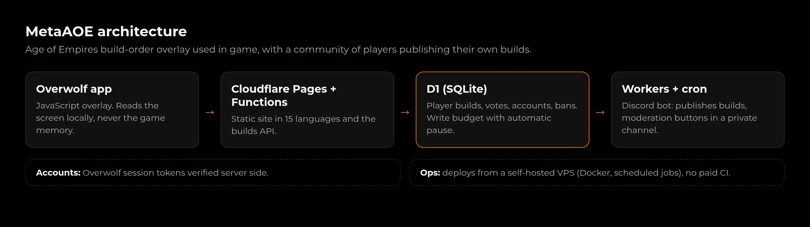

I'm a 42 Nice student looking for a **DevOps / Cloud / SRE apprenticeship** in Nice, Sophia Antipolis or Monaco.

I run apps with real users on my own: I ship them, automate them, monitor them, and fix them when they break.

  

## GaijinToSensei, in production

[gajintosensei.com](https://gajintosensei.com) teaches Japanese to French speakers: lessons, quizzes, an AI that corrects your sentences, Stripe subscriptions. I build it and run it end to end.

- [Case study](https://zapz.work/en/projects/gaijintosensei/): how several agents and I ship to prod safely.
- [Postmortem](https://zapz.work/en/projects/database-incident/): the day a migration wiped the production database, and how it came back.

## MetaAOE, serverless on Cloudflare

An in-game build-order overlay for Age of Empires (Overwolf app), where players publish and vote on their own builds.

## Self-hosted infra

A Linux VPS running Docker, Cloudflare Tunnel, scheduled jobs and the deploy tooling for all of the above. [More here](https://zapz.work/en/projects/personal-infra/).

## Background

- Low level first: C, C++ and x86-64 assembly at 42, reverse engineering with x64dbg and Binary Ninja.
- Worked in Tokyo as a localization QA tester at Keywords Studios.
- French, English (professional), Japanese (JLPT N5).

**[zapz.work](https://zapz.work/en/)** · [LinkedIn](https://www.linkedin.com/in/matteo-murru-775720274/) · contact@zapz.work · [CV (PDF)](https://zapz.work/cv-en.pdf)

Most of my 42 projects stay private, as the school's rules ask.
