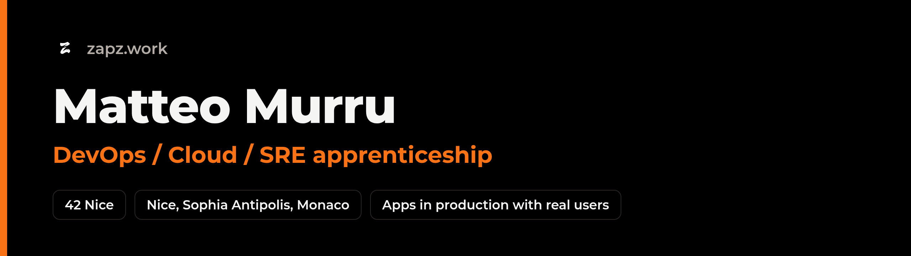

Étudiant à 42 Nice, je cherche une **alternance DevOps / Cloud / SRE d'un an** à Nice, Sophia Antipolis ou Monaco. Je postule aussi à des **stages en IA agentique**.

Je fais tourner seul une app en production, avec de vrais utilisateurs. Des agents Claude Code écrivent la plupart de son code. Mon travail, c'est tout ce qui les empêche de casser la prod.

## Projets

**GaijinToSensei**, [gajintosensei.com](https://gajintosensei.com)
App pour apprendre le japonais : Next.js, PostgreSQL (Neon) avec Prisma, Redis (Upstash), Cloudflare Workers. Chaque mise en prod passe par un script : préversion sans trafic, contrôles, activation, nouveau contrôle, et retour seul à la version précédente si ça échoue. Quand le compte gratuit Vercel a été coupé, je l'ai migrée sur Cloudflare Workers le jour même, et le temps de réponse du serveur est passé de 0,26-0,30 s à 0,07-0,09 s. [Étude de cas](https://zapz.work/projets/gaijintosensei/)

**La chaîne d'agents de GaijinToSensei**
Trois agents Claude Code travaillent en parallèle, chacun sur sa branche (`w1`, `w2`, `w3`). Ils ont écrit 479 des 724 commits du dépôt. Un jour, une migration lancée par un agent a visé la base de prod au lieu d'une base jetable et l'a vidée. Je l'ai restaurée par point-in-time restore, j'ai écrit le postmortem, et depuis les agents n'ont plus aucun droit destructif sur la prod. [Postmortem](https://zapz.work/projets/incident-base-de-donnees/)

**[steam-roblox-agents](https://github.com/ZapzCsgo/steam-roblox-agents)**
Système multi-agents LangGraph en Python : il dit si un jeu Steam en tendance mérite une adaptation Roblox. Un agent critique renvoie la note à l'analyste quand elle ne tient pas. Il est évalué sur 21 cas passés ; la méthode et le détail sont dans le dépôt.

**Infra perso**
Un VPS Linux où des agents tournent la nuit en service systemd, sans droits root, avec 25 tâches planifiées (garde de prod, publications, alertes). 5 sites statiques se publient seuls sur Cloudflare Pages. [Détails](https://zapz.work/projets/infra-perso/)

**zapz.work**
Mon portfolio : Astro statique, CI GitHub Actions (lint, build, liens, recherche de secrets, Lighthouse), image Docker sur GHCR, hébergé sur Cloudflare Workers. [Comment il est déployé](https://zapz.work/comment-ce-site-est-deploye/)

## Outils

- En prod : Linux (systemd, cron), Bash, Git, Cloudflare (Workers, Pages, Tunnel), PostgreSQL, Prisma, Redis, Node.js, TypeScript, Python, Claude Code
- En apprentissage : Docker, Ansible, GitHub Actions, LangGraph, AWS (Cloud Practitioner en cours)
- À 42 : C, C++, assembleur x86-64 ([libasm](https://github.com/ZapzCsgo/Libasm)), appels système, format ELF

## Contact

contact@zapz.work | [zapz.work](https://zapz.work) | [LinkedIn](https://www.linkedin.com/in/matteo-murru-775720274/) | [CV (PDF)](https://zapz.work/cv.pdf)

---

### In English

42 Nice student looking for a 1-year DevOps / Cloud / SRE work-study contract in Nice, Sophia Antipolis or Monaco, and applying to agentic AI internships. I run an app in production with real users on my own. Claude Code agents wrote 479 of its 724 commits; I build the guardrails around them: checked releases with automatic rollback, a postmortem after an agent's migration wiped the production database, and no destructive rights for agents since. Portfolio and resume: [zapz.work/en](https://zapz.work/en/).
